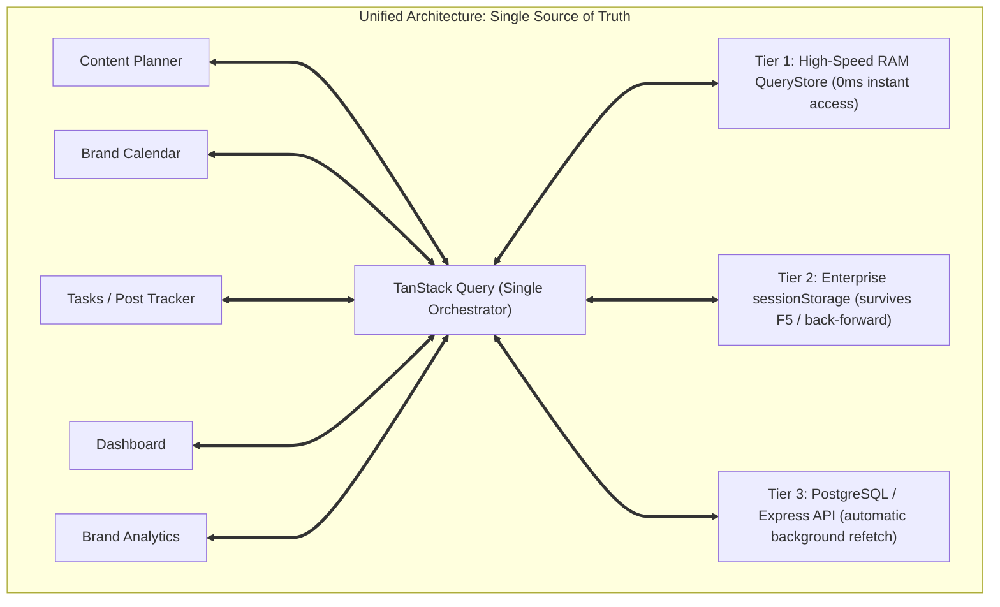
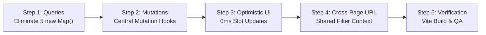

# Enterprise Architecture Plan: Single Source of Truth & Zero-Latency Reactivity

## 1. Executive Summary & Core Objective

The MoonPulse frontend currently uses a hybrid, fragmented caching system where **five separate in-memory `new Map()` instances** coexist with **TanStack Query (React Query)** and **browser `sessionStorage`**. 

This fragmentation causes data isolation (*cache islands*): when a user creates, duplicates, edits, or deletes a post or deliverable slot, one cache updates while the others remain stale for 3 to 5 minutes unless a user forces an F5 browser reload.

**Objective:**
Eliminate all 5 ad-hoc `new Map()` caches and establish **TanStack Query as the Single Source of Truth**. Guarantee that every write mutation (Add, Update, Delete) instantly propagates across all screens (Planner, Calendar, Tasks, Dashboard, Brand Analytics) with **0ms latency** while preserving instant rendering on navigation.

---

## 2. Problem Statement: Current Architectural Gaps

```mermaid
flowchart TD
    subgraph CURRENT ["Current Fragmented Architecture (5 Isolated Cache Islands)"]
        UI1["Planner & Post Tracker"] --> TQ["TanStack Query (RAM + SessionStorage)"]
        UI2["Brand Statistics"] --> MAP1["brandCache = new Map() (5 min TTL)"]
        UI3["Dashboard KPI & Profit"] --> MAP2["dashboardCache = new Map() (3 min TTL)"]
        UI4["Deliverables Hub"] --> MAP3["hubCache = new Map() (5 min TTL)"]
        UI5["Brand Detail Missions"] --> MAP4["window.__mission_cache = new Map()"]
        UI6["Product Catalog"] --> MAP5["productCache = new Map() (5 min TTL)"]
    end
    
    subgraph PROBLEM ["Symptoms"]
        MUT["Post / Slot Mutation (Create / Edit / Delete)"] -.->|Only invalidates TQ| TQ
        MUT -.x|Blind: Cannot reach| MAP1
        MUT -.x|Blind: Cannot reach| MAP2
        MUT -.x|Blind: Cannot reach| MAP3
        MUT -.x|Blind: Cannot reach| MAP4
        MUT -.x|Blind: Cannot reach| MAP5
    end
```

### Key Issues Identified:
1. **Ad-hoc `new Map()` caches are non-reactive:** React components do not re-render when a `Map.set()` or `Map.delete()` occurs.
2. **Scattered Mutations:** UI components directly invoke raw Axios API endpoints (`api.createPost`, `missionApi.deleteSlot`) instead of centralized mutation hooks, causing developers to forget cache invalidation.
3. **No Optimistic Updates:** Scheduling a post or duplicate blocks the UI until the server roundtrip finishes (1-3 seconds), instead of instantly flipping the target slot to "Scheduled".
4. **Missing Dependency Arrays:** Variables like `brandFilter` in `PlannerPage.jsx` omitted from `useMemo` dependencies because ESLint hooks rules were not strictly enforced.

---

## 3. Target Architecture: Unified Multi-Tier Cache



### How the Multi-Tier System Works:
- **Tier 1 (RAM):** Queries reside in React Query's internal memory store. Navigating between components takes **0ms**.
- **Tier 2 (Session Storage):** Debounced serialization writes query data to browser `sessionStorage`. On page refresh (F5), cache rehydrates in **< 1ms** before React renders.
- **Tier 3 (Network / Server):** Automatic background re-validation occurs whenever queries become stale or are explicitly invalidated.

---

## 4. Detailed Implementation Phases

### Phase 1: Complete Elimination of the 5 Ad-hoc `new Map()` Caches

| # | File | Current Legacy Cache | Target TanStack Query Solution |
|---|---|---|---|
| **1.1** | [`brandStatsService.js`](file:///c:/Users/myide/Desktop/PERN_Stack/MoonPulse/frontend/src/features/statistics/services/brandStatsService.js) | `const brandCache = new Map()` (TTL 5m) | Create `useBrandStats(params)` and `useBrandDetail(id, params)` hooks using `queryKeys.statistics.brand(...)`. Delete `brandCache`. |
| **1.2** | [`DashboardPage.jsx`](file:///c:/Users/myide/Desktop/PERN_Stack/MoonPulse/frontend/src/features/dashboard/pages/DashboardPage.jsx) | `const dashboardCache = new Map()` (TTL 3m) | Create `useDashboardStats(range, platform)` and `useDashboardProfit(range, platform)` hooks. Delete `dashboardCache`. |
| **1.3** | [`BrandUnifiedExpandableHub.jsx`](file:///c:/Users/myide/Desktop/PERN_Stack/MoonPulse/frontend/src/features/missions/components/BrandUnifiedExpandableHub.jsx) | `const hubCache = new Map()` (TTL 5m) | Replace custom loader with standard `useMonthAudit(month, year)` and `useCalendarSlots('all', month, year)`. Delete `hubCache`. |
| **1.4** | [`BrandDetailPage.jsx`](file:///c:/Users/myide/Desktop/PERN_Stack/MoonPulse/frontend/src/features/statistics/pages/BrandDetailPage.jsx) | `window.__moonpulse_mission_cache` | Replace with standard `useCalendarSlots(brandId, month, year)`. Delete window global cache. |
| **1.5** | [`productService.js`](file:///c:/Users/myide/Desktop/PERN_Stack/MoonPulse/frontend/src/features/product/services/productService.js) | `const productCache = new Map()` (TTL 5m) | Standardize `useProducts()` to use TanStack Query cache. Delete `productCache`. |

---

### Phase 2: Centralized Mutation Hooks Layer (`usePostMutations` & `useSlotMutations`)

Components will **never** call raw Axios APIs for mutations directly. All mutations will route through two centralized hooks:

#### 1. `usePostMutations()`
* Located at: `frontend/src/features/postTracker/hooks/usePostMutations.js`
* Provides:
  - `createPost(payload)`
  - `updatePost(id, payload)`
  - `deletePost(id)`
  - `duplicatePost(sourcePost, scheduleConfig)`
  - `publishNow(id)`
* **Automatic Invalidation:** Every mutation automatically calls `queryClient.invalidateQueries` for:
  - `queryKeys.posts.all`
  - `queryKeys.missions.all`
  - `queryKeys.statistics.all`

#### 2. `useSlotMutations()`
* Located at: `frontend/src/features/missions/hooks/useSlotMutations.js`
* Provides:
  - `createSlot(payload)`
  - `updateSlot(id, payload)`
  - `deleteSlot(id)`
* **Automatic Invalidation:** Automatically invalidates `missions.all` and `statistics.all`.

---

### Phase 3: Optimistic UI Updates (The 0ms Super-Fast Feel)

For post duplication and scheduling into deliverable slots:
1. **`onMutate`:** When the user clicks "Schedule Post" or "Duplicate Post":
   - Cancel outgoing queries for `['missions']` and `['posts']`.
   - Snapshot previous cache state.
   - Optimistically inject the new post into the active date cell.
   - Optimistically mark the planned slot as **`Scheduled`** (color changes immediately from dashed green to solid blue badge).
2. **`onError`:** If backend fails, roll back to snapshot and trigger toast notification.
3. **`onSettled`:** Perform final reconciliation with server database.

---

### Phase 4: ESLint Guardrails (`react-hooks/exhaustive-deps`)

* Ensure `eslint-plugin-react-hooks` enforces `"error"` or `"warn"` for `exhaustive-deps`.
* Audit all `useMemo` and `useEffect` across `PlannerPage.jsx`, `BrandCalendarPage.jsx`, and `BrandDetailPage.jsx` to prevent missing filter variables like `brandFilter`.

---

### Phase 5: Cross-Page URL State Synchronization

* Enable query parameter sharing across:
  - `/planner?brand_id=3&month=11&year=2026&view=week`
  - `/calendar?brand_id=3&month=11&year=2026`
  - `/brands/3?month=11&year=2026`
* When switching tabs, the user's active brand selection and month/year context are preserved automatically.

---

## 5. Execution Steps & Verification Matrix



### Verification Criteria:
1. **Zero Ad-hoc Maps:** Grepping `new Map()` in `frontend/src` returns zero cache storage maps (only valid data structures like `postsByDate` grouping allowed).
2. **Instant Slot Reconciliation:** Duplicating or creating a post immediately flips the planned slot on `/planner` and `/calendar` without page refresh.
3. **Brand Filter Smoothness:** Switching Brand dropdown in `/planner` filters cards instantly (0ms delay).
4. **Vite Production Build:** `npm run build` must succeed with 0 errors and 0 warnings.
5. **Session Persistence:** Hard refreshing (F5) on any page must rehydrate data in `< 1ms` without skeleton flashes.

