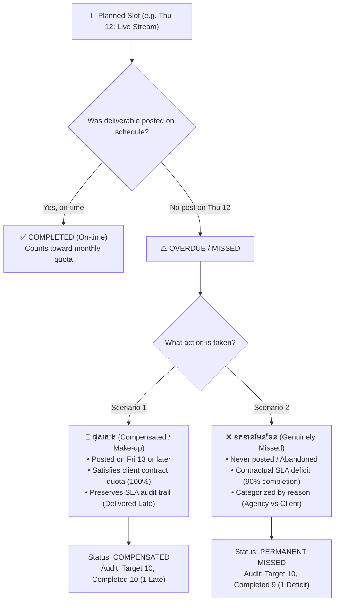
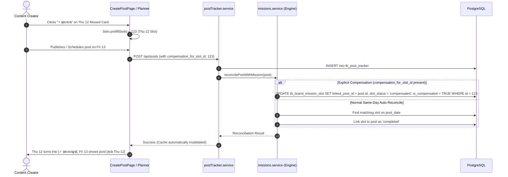

# Architecture Plan: Missed & Compensation Deliverable System (ផុសសង & ខកខាន)

> **Folder:** `plan/`  
> **Document:** `4_missed_and_compensation_architecture_plan.md`  
> **Status:** Implemented & Verified in Production  
> **Target Audience:** Engineering Team, Product Lead, Social Media Operations Lead  
> **Date:** November 2026  

---

## 1. Executive Summary & Business Domain Realities

In social media agency operations managing high-value brand contracts, **daily scheduled deliverables do not always happen on exact calendar dates**. Real agency operations face two distinct business scenarios when a scheduled deliverable date passes without a post:



### The Core Business Rules:
1. **Scenario 1: ផុសសង (Compensated / Backfilled)**
   - The agency missed posting on the contract date (Thu 12), but made up for it on Fri 13 or over the weekend.
   - **Client Quota Outcome**: The contract target **IS fulfilled** (client got their deliverables).
   - **Audit Outcome**: The agency tracks that it was delivered late (`is_compensated: true`), providing transparency.
2. **Scenario 2: ខកខានមែនទែន (Genuinely Missed / Forfeited)**
   - The deliverable was missed and was **NEVER made up** by month-end.
   - **Client Quota Outcome**: A **contractual deficit** (e.g., paid for 10 deliverables, received 9).
   - **Accountability**: Must categorize *why* it was missed (Agency fault vs. Client requested holiday / artwork delay).

---

## 2. Current Architectural Flaws & Root Cause

| Current Implementation | Why It Breaks for "ផុសសង" (Make-up) | Target Architecture |
| :--- | :--- | :--- |
| **Strict Same-Day Matching** (`planned_date === post_date`) | If a post is published on Fri 13 to make up for Thu 12, the system looks *only* on Fri 13. Thu 12 remains permanently `MISSED`, and Fri 13 is treated as an `EXTRA/UNPLANNED POST`. | **Explicit & Directed Linking**: Post carries `compensation_for_slot_id` pointing directly to Thu 12's slot across dates. |
| **No "Compensated" State** | Slots only have 4 hardcoded statuses: `planned`, `scheduled`, `completed`, `missed`. | Add `compensated` status + `is_compensated: boolean` with link to the fulfilling post. |
| **Audit Quota Miscalculation** | Monthly Audit penalizes the agency because the missed slot shows `0%`, ignoring the extra make-up post. | Audit counts both `on_time_completed` and `compensated_completed` toward the final contract quota. |
| **No Reason Tagging** | A missed slot has no explanation of *why* it was missed. | Add `missed_reason` (`agency_delay`, `client_requested_hold`, `artwork_pending`, `holiday`). |

---

## 3. Database Schema Enhancements (PostgreSQL)

### A. Update `tb_brand_mission_slot`
Add tracking fields to record compensation and reason categorizations:

```sql
-- Migration: Add compensation & missed classification to tb_brand_mission_slot
ALTER TABLE tb_brand_mission_slot 
  DROP CONSTRAINT IF EXISTS tb_brand_mission_slot_slot_status_check;

ALTER TABLE tb_brand_mission_slot 
  ADD CONSTRAINT tb_brand_mission_slot_slot_status_check 
  CHECK (slot_status IN ('planned', 'scheduled', 'completed', 'compensated', 'missed', 'waived'));

ALTER TABLE tb_brand_mission_slot
  ADD COLUMN IF NOT EXISTS is_compensated BOOLEAN DEFAULT FALSE,
  ADD COLUMN IF NOT EXISTS compensated_at TIMESTAMP WITH TIME ZONE NULL,
  ADD COLUMN IF NOT EXISTS missed_reason VARCHAR(50) NULL,
  ADD COLUMN IF NOT EXISTS resolution_notes TEXT NULL;

-- Index for fast lookup of pending or uncompensated slots by brand
CREATE INDEX IF NOT EXISTS idx_slots_uncompensated 
  ON tb_brand_mission_slot(mission_id, slot_status, is_compensated);
```

### B. Update `tb_post_tracker`
Allow a post to declare which planned deliverable slot it fulfills (even if published on a different date):

```sql
ALTER TABLE tb_post_tracker
  ADD COLUMN IF NOT EXISTS compensation_for_slot_id INT 
  REFERENCES tb_brand_mission_slot(id) ON DELETE SET NULL;

CREATE INDEX IF NOT EXISTS idx_post_compensation_slot 
  ON tb_post_tracker(compensation_for_slot_id);
```

---

## 4. Backend Engine: Reconciliation & Audit Logic



### 1. Enhanced `reconcilePostWithMission(post)`
In `server/src/modules/missions/missions.service.js`:

```javascript
// Step 1: Explicit Compensation Linking (Highest Priority)
if (post.compensation_for_slot_id) {
  const targetSlot = await missionsRepo.getSlotById(post.compensation_for_slot_id);
  if (targetSlot) {
    await missionsRepo.linkSlotAsCompensated(targetSlot.id, post.id);
    return { slotId: targetSlot.id, mode: 'compensated' };
  }
}

// Step 2: Normal Same-Day Linking
const sameDaySlot = await missionsRepo.findUnlinkedSlotForPost({
  brand_id: post.brand_id,
  planned_date: postDateStr,
  content_type: post.media_type || 'photo',
});
if (sameDaySlot) {
  await missionsRepo.linkSlotToPost(sameDaySlot.id, post.id, targetStatus);
  return { slotId: sameDaySlot.id, mode: 'on_time' };
}
```

### 2. Enhanced Monthly Audit Calculation Formula
In `missions.service.js` (`getMonthAudit`):
```javascript
const completedOnTime = slots.filter(s => s.slot_status === 'completed' && !s.is_compensated).length;
const completedCompensated = slots.filter(s => s.slot_status === 'compensated' || s.is_compensated).length;
const totalFulfilled = completedOnTime + completedCompensated;
const totalMissed = slots.filter(s => s.computed_status === 'missed' && !s.is_compensated).length;
const completionRate = totalTarget > 0 ? Math.round((totalFulfilled / totalTarget) * 100) : 0;
```

---

## 5. Frontend UI/UX Workflows

### A. The "ផុសសង" (Make-up) Workflow in Planner & Brand Calendar

````carousel
```markdown
### 1. Thu 12: Missed Slot Card
The card displays:
- Badge: `⚠️ MISSED` (in red/coral)
- Button: `+ ផុសសង (Compensate)`
- Clicking it opens `CreatePostPage` pre-attached to Thu 12's slot.
```
<!-- slide -->
```markdown
### 2. CreatePostPage: Compensation Notice Banner
At the top of the form:
- Blue alert banner:
  "🔁 កំពុងផុសសងសម្រាប់: [Thu 12] Welait · Live Stream"
- User can change or detach if they want to post normally.
```
<!-- slide -->
```markdown
### 3. After Publishing on Fri 13
- **Thu 12 Slot**: Turns from red `⚠️ MISSED` to purple/blue `🔄 ផុសសងរួច (Compensated)`.
  Tooltip: "Compensated by post on Fri 13 at 2:00 PM".
- **Fri 13 Post**: Appears on Fri 13 with an indicator pill: `[សងជំនួស Thu 12]`.
- **Monthly Audit Quota**: Counts 1/1 Completed (100% Client Fulfillment)!
```
````

### B. The "ខកខានមែនទែន" (Genuinely Missed) Workflow

1. If no compensation post is linked by the end of the month:
   - The slot remains permanently flagged as **`⚠️ MISSED`**.
2. **Reason Modal on Missed Card**:
   - Clicking a small `...` or setting button on a missed slot lets managers set the reason:
     - 🏢 *Agency Delay (ភ្លេចផុស / ខកខានដោយសារក្រុមការងារ)*
     - 👤 *Client Delay (Client មិនទាន់ទម្លាក់ផលិតផល ឬ Artwork)*
     - ⏸️ *Client Waived (Client សុំផ្អាកដោយឯកភាព)*
3. **Monthly Audit Report**:
   - Explicit breakdown table showing:
     - Total Contract Target: 10
     - Delivered On-Time: 8
     - Delivered Late (ផុសសង): 1
     - Unresolved Missed: 1 (Agency Delay: 1)
     - **Final SLA Score: 90%**

---

## 6. Implementation Roadmap & Milestones

| Milestone | Task Description | Primary Files |
| :--- | :--- | :--- |
| **Phase 1** | Run SQL migration to add `is_compensated`, `compensated_at`, `missed_reason`, and `compensation_for_slot_id`. | `server/src/scripts/migrate_compensation_schema.js` |
| **Phase 2** | Update backend repository & service to support explicit compensation linking and enhanced audit calculation. | `missions.repository.js`, `missions.service.js`, `postTracker.service.js` |
| **Phase 3** | Update `CreatePostPage.jsx` & `EditPostPage.jsx` to receive `compensationSlotId` and send it with the post payload. | `CreatePostPage.jsx`, `EditPostPage.jsx` |
| **Phase 4** | Update `PlannerPage.jsx` and `BrandCalendarPage.jsx` to render the `🔄 ផុសសងរួច` (Compensated) badge and `+ ផុសសង` trigger button. | `PlannerPage.jsx`, `BrandCalendarPage.jsx`, `planner.css` |
| **Phase 5** | Verify end-to-end: Create missed slot -> Click "+ ផុសសង" -> Publish next day -> Confirm slot turns Compensated and audit quota reaches 100%. | Manual & API verification |

---

## 7. Recommendation & Next Steps

This plan directly solves both real-world business challenges:
1. It eliminates the frustration of posts made up on later days being treated as "unplanned extra posts".
2. It gives clear, contract-compliant audit reporting so clients and managers always know the exact delivery status.

Please review this architecture plan. Once approved, we will begin with **Phase 1 (Database Migration)** and **Phase 2 (Backend Service Linking)**.
