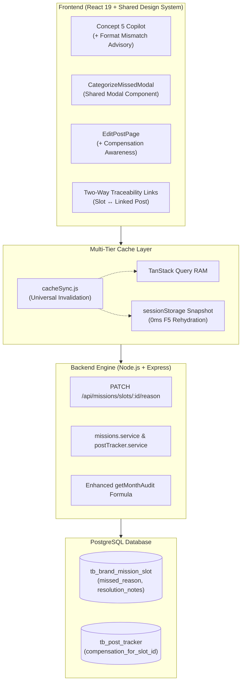

# Architecture Plan: Advanced Compensation & Deliverable Closure System

> **Document ID:** `plan/5_compensation_and_missed_closure_plan.md`  
> **Status:** Draft for Review & Approval  
> **Core Architecture Focus:** Multi-tier Cache Sync, Global Component Reuse, PERN Strict Layering  
> **Target Audience:** Engineering Team, Product Lead, Social Media Operations Lead  
> **Date:** November 2026  

---

## 1. Executive Summary & Architectural Tenets

This plan defines the final, production-grade completion of the **Missed Deliverable & Compensation (ផុសសង) System** in MoonPulse. 

Every new capability in this plan strictly adheres to our core enterprise standards:
1. **Multi-tier Cache Synchronization (`cacheSync.js`):** Every creation, reason categorization, edit, or detachment instantly invalidates and synchronizes across TanStack Query RAM, `sessionStorage` rehydration (`MOONPULSE_SESSION_QUERY_CACHE`), and singleton module caches.
2. **Global Component Design System (`shared/components/ui`):** Zero ad-hoc modals or custom buttons. Reuses existing `<Modal>`, `<Button>`, `<Select>`, `<DatePicker>`, and `<ToastContext>`.
3. **Strict PERN Layering:** Clean flow through Controller $\to$ Service $\to$ Repository $\to$ PostgreSQL with parameterized queries and transaction safety.



---

## 2. The 5 Architectural Pillars

### Pillar 1: Smart Content Format Validation in Concept 5 Copilot
> [!IMPORTANT]
> In agency contracts, a **Video** deliverable carries significantly higher billing and production weight than a **Photo** or text post. The system must prevent accidental fulfillment of high-value video contracts with simple image posts.

#### Behavior:
- **Detection Logic:**
  - If `compensationSlot.content_type === 'video'` and the current post only has images or text $\to$ **Warning Advisory**.
  - If `compensationSlot.content_type === 'photo'` and the current post is a video $\to$ **Info Notice** (upgrade deliverable).
  - If formats match $\to$ **Format Verified Badge** (`[ ✓ Video Verified ]`).
- **Visual Presentation:** A sleek, non-blocking amber warning callout inside `.meta-copilot-card`:
  ```
  ⚠️ Format Mismatch Warning:
  Slot #67 contract requires a VIDEO deliverable, but your post currently contains Photos.
  ```

#### Dropdown Polish:
- Format date label in the dropdown selector from `#67 · 2026-11-14 · VIDEO` to `#67 · Sat, Nov 14, 2026 · VIDEO`.
- Hide the "Switch to other missed slot:" block when only 1 missed slot exists.

---

### Pillar 2: "Permanent Missed" (ខកខានមែនទែន) Reason Categorization
> [!NOTE]
> Not all missed deliverables are made up. When the month ends or a client cancels, the slot must be formally closed with an accountability audit trail.

#### Data Model (`tb_brand_mission_slot`):
- `missed_reason VARCHAR(50)`:
  - `agency_delay`: Missed due to agency team / internal execution delay.
  - `client_delay`: Client delayed artwork, product delivery, or brief approval.
  - `client_waived`: Client formally requested hold / agreed to waive deliverable.
  - `holiday_force_majeure`: Public holiday or unforeseen circumstances.
- `resolution_notes TEXT`: Explanatory context from the account manager.

#### Backend Implementation:
- **Route:** `PATCH /api/missions/slots/:id/reason`
- **Controller:** `missions.controller.js` $\to$ `updateSlotReason`
- **Service:** `missions.service.js` $\to$ `setSlotMissedReason(slotId, reason, notes, status)`
- **Repository:** `missions.repository.js` $\to$ `updateSlotReason(slotId, reason, notes)`

#### Frontend Implementation:
- **Global Modal:** `CategorizeMissedModal.jsx` using `shared/components/ui/Modal/Modal.jsx` and `shared/components/ui/Button/Button.jsx`.
- **Triggers:** Available from `BrandCalendarPage.jsx` and `PlannerPage.jsx` when clicking a missed deliverable slot.
- **Cache Invalidation:** Calls `invalidateMissionCaches()` upon save.

---

### Pillar 3: Post Maintenance Lifecycle in `EditPostPage.jsx`
> [!WARNING]
> Currently, opening an existing make-up post in `EditPostPage.jsx` has zero compensation visibility. Rescheduling or editing risks breaking deliverable links.

#### Behavior:
1. `EditPostPage.jsx` fetches `compensation_for_slot_id` from the existing post record.
2. If present, displays a compact **Mission Copilot Linked Banner** above the editor:
   `[ 💡 Fulfilling Make-Up: Slot #67 · VIDEO (Sat, Nov 14, 2026) · Brand: Gaullac ]`
3. Allows changing or detaching the compensation link.
4. On save, passes `compensation_for_slot_id` to `editPostData` in `postTracker.service.js`, preserving or updating the link cleanly.

---

### Pillar 4: Two-Way Traceability & Deep Linking
> [!TIP]
> Operations managers need seamless navigation between contract slots and published Facebook posts.

#### Bi-directional Links:
1. **From Slot to Post:** In `BrandCalendarPage` slot modal:
   - When a slot is `[ ✓ COMPENSATED ]` or `[ ✓ LIVE ON FB ]`, display:
     `[ 🔗 View Published Post & Metrics ]` $\to$ Opens post drawer / navigates to tracked post.
2. **From Post to Slot:** On the Planner / Post card:
   - Displays `[ Make-Up: Slot #67 ]`.
   - Clicking it navigates directly to the original missed date in the calendar and highlights the fulfilled slot.

---

### Pillar 5: Detailed Monthly Audit & SLA Formula
Enhance `getMonthAudit` in `missions.service.js` and the reporting views in `BrandStatsPage`:

```javascript
// Enhanced Audit Metrics
const totalSlots = enrichedSlots.length;
const completedOnTime = enrichedSlots.filter(s => s.computed_status === 'completed' && !s.is_compensated).length;
const completedCompensated = enrichedSlots.filter(s => s.is_compensated).length;
const unresolvedMissed = enrichedSlots.filter(s => s.computed_status === 'missed').length;
const waivedSlots = enrichedSlots.filter(s => s.computed_status === 'waived').length;

// Final Contract Fulfillment vs SLA Quality
const totalContractDelivered = completedOnTime + completedCompensated;
const contractFulfillmentRate = totalSlots > 0 ? Math.round((totalContractDelivered / totalSlots) * 100) : 0;
const onTimeDeliveryRate = totalSlots > 0 ? Math.round((completedOnTime / totalSlots) * 100) : 0;
```

---

## 3. Implementation Phases & Milestones

| Phase | Scope | Target Files |
| :--- | :--- | :--- |
| **Phase 1** | **Copilot Format Advisory & Polish**<br>• Add media format mismatch warning in Copilot<br>• Format dropdown dates nicely (`Sat, Nov 14, 2026`)<br>• Condition single vs multi-slot dropdown | `CreatePostPage.jsx`<br>`postTracker.css` |
| **Phase 2** | **Permanent Missed API & Backend**<br>• `PATCH /api/missions/slots/:id/reason`<br>• Parameterized repository update<br>• Enhanced audit formula | `missions.routes.js`<br>`missions.controller.js`<br>`missions.service.js`<br>`missions.repository.js` |
| **Phase 3** | **Global CategorizeMissedModal**<br>• Reusable modal using `shared/components/ui/Modal`<br>• Wire into `BrandCalendarPage` and `PlannerPage`<br>• Trigger `cacheSync.js` on submit | `CategorizeMissedModal.jsx`<br>`BrandCalendarPage.jsx`<br>`PlannerPage.jsx` |
| **Phase 4** | **EditPostPage Lifecycle Support**<br>• Load `compensation_for_slot_id`<br>• Display Copilot linked card<br>• Support retaining or detaching on update | `EditPostPage.jsx`<br>`postTracker.service.js` |
| **Phase 5** | **Two-Way Deep Linking & Build Verification**<br>• Slot modal $\leftrightarrow$ Post card navigation<br>• Run `npm run build` with zero errors | `BrandCalendarPage.jsx`<br>`PlannerPage.jsx` |

---

## 4. Verification & Testing Criteria

1. **Format Validation:** Create a post for Slot #67 (`Format: VIDEO`) with images attached. Confirm amber warning appears. Switch media to a video file; confirm warning clears and verified badge shows.
2. **Permanent Missed Categorization:** Open a past missed slot in `BrandCalendarPage`. Click "Categorize Reason". Select "Client Delay" with notes. Save and confirm slot shows reason tag, and cache updates instantly.
3. **Edit Lifecycle:** Open a compensated post in `EditPostPage.jsx`. Confirm Copilot shows the linked slot. Save edit and verify slot remains linked.
4. **Cache & Render Performance:** Confirm 0ms rehydration after hard refresh and zero stale reads.
