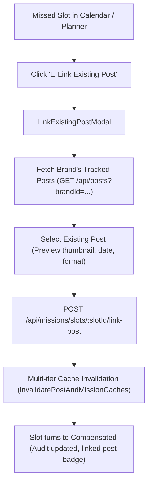

# Plan: Reconciling Existing Tracked Posts with Missed Slots (ផុសសង Reconciler)

## 1. Problem Statement & Real-World Workflow
- **Current Issue:** A teammate publishes/tracks a deliverable in MoonPulse on time, but forgets to click "Link as Make-Up" to link it back to a previous missed slot. Later, the manager/auditor notices the open missed slot (e.g. Slot #169) and tries to reconcile it. If they try to track it from Facebook, the system rejects it with `❌ This Facebook post is already tracked`.
- **User's Goal:** The post already exists in MoonPulse's database. The manager simply wants to select that existing post and link it to the missed slot without re-importing from Facebook or leaving the Calendar.

---

## 2. Architectural Pillars

### Pillar 1: Backend Layer (PERN Architecture)
- **Repository (`missions.repository.js`)**:
  - `linkSlotToPost(slotId, postId, status, isCompensated)`: Updates `tb_brand_mission_slot` (`linked_post_id`, `slot_status = 'compensated'`, `is_compensated = true`, `compensated_at = NOW()`).
  - `unlinkSlotBySlotId(slotId)`: Resets `linked_post_id = NULL`, `slot_status = 'planned'`, `is_compensated = false`, `compensated_at = NULL`.
- **Repository (`postTracker.repository.js`)**:
  - Update `tb_post_tracker.compensation_for_slot_id = slotId` (or `NULL` on unlink).
- **Service (`missions.service.js`)**:
  - `linkPostToSlot(slotId, postId)`: Validates slot and post existence, assigns `compensation_for_slot_id` to post, links slot as compensated, triggers audit recalculation.
  - `unlinkPostFromSlot(slotId)`: Clears slot link and post's `compensation_for_slot_id`.
- **Controller (`missions.controller.js`) & Routes (`missions.routes.js`)**:
  - `POST /api/missions/slots/:id/link-post` with body `{ postId }`.
  - `POST /api/missions/slots/:id/unlink-post`.

### Pillar 2: `LinkExistingPostModal.jsx` (Global Design System Component)
- Built with standard UI components: `Modal`, `ModalHeader`, `ModalBody`, `ModalFooter`, `Button`, `Skeleton`, `ToastContext`.
- **Features**:
  - Fetches recent tracked posts for the slot's brand (`api.getPosts({ brandId, limit: 30 })`).
  - Search filter (by caption / FB Post ID).
  - Format badges (`VIDEO`, `PHOTO`, `LIVE`) with Lucide icons.
  - Media compatibility advisory (e.g., highlighting format match with the slot contract).
  - Single-click selection with preview card.
  - "Attach to Slot #{slotId}" submit button with loading state.
  - Cache synchronization via `invalidatePostAndMissionCaches()`.

### Pillar 3: Integration into Brand Calendar & Planner
- **`BrandCalendarPage.jsx`**:
  - In Day Detail Modal for missed slots: Add `🔗 Link Existing Post` button next to `⚙ Set Reason` and `Post Make-Up 🚀`.
  - For already compensated slots: Display linked post summary with `Unlink` button.
- **`PlannerPage.jsx`**:
  - On missed slot items: Add `🔗 Link Existing Post` option.

### Pillar 4: Frictionless Fallback in `CreatePostPage.jsx`
- When `compensationSlot` is active and user switches to "Pick from Recent Posts":
  - If the selected Facebook post is already tracked in MoonPulse, do **NOT** show a blocking error.
  - Instead, display: `ℹ️ This post is already tracked in MoonPulse (#ID). Click below to link it as make-up.`
  - The submit button changes to: **`🔗 Link Existing Post to Slot #${compensationSlot.id}`**.
  - Submitting calls the link API, clears the draft, invalidates caches, and redirects back to Calendar/Planner.

---

## 3. Verification & Safety Steps
1. Unit check backend endpoints with `node -e`.
2. Verify full frontend build with `npm run build --prefix frontend`.
3. Test edge cases:
   - Linking a post that was already linked to another slot (warns or reassigns).
   - Unlinking a compensated slot (restores missed/planned status and recalculates SLA audit).
   - Format mismatch advisory (e.g. video post for photo slot = upgrade, photo post for video slot = warning).
