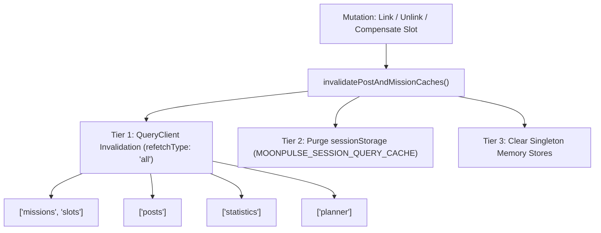

# Plan 7: Enterprise System Architecture & Professional Design Patterns Specification
**Mission Deliverables, Auto-Reconciliation & Multi-Tier Cache Synchronization**

---

## 1. Executive Summary & Problem Landscape

In modern media agency operations, client deliverable schedules (**Brand Missions**) and actual social media publications (**Tracked Posts**) must remain strictly synchronized. When deliverables are missed (due to client delays, content adjustments, or scheduling friction), the system supports compensatory deliverables (**ផុសសង Make-Up Posts**).

### Real-World Symptoms Resolved:
1. **Modal Closure Failure:** `LinkExistingPostModal` and `CategorizeMissedModal` remained visible after submission, requiring manual dismiss.
2. **Stale View Snapshot:** The Day Detail Modal and Calendar grid continued displaying the red/missed state after manual dismiss until a fresh browser session was opened.
3. **Cross-Feature Cache Desynchronization:** Linking or unlinking in Calendar did not immediately propagate to the Planner or Mission Audit views.

---

## 2. Professional Software Engineering Design Patterns Applied

### Pattern 1: Defensive API Design & The Adapter Pattern (Postel's Law)
* **Root Cause:** Caller components destructured `{ showSuccess, showError } = useToast()`, whereas the original `ToastContext` exposed `{ success, error }`. Under standard JavaScript execution, calling `undefined()` threw an uncaught `TypeError`, prematurely halting the execution chain before `onClose()` and `onLinked()` callbacks could execute.
* **Architectural Implementation:**
  - Applied **Postel's Law (Robustness Principle)**: *"Be conservative in what you do, be liberal in what you accept from others."*
  - Built polymorphic method aliases into `ToastContext`:
    ```javascript
    const toast = useMemo(
      () => ({
        success: (msg, duration) => addToast(msg, 'success', duration),
        error: (msg, duration) => addToast(msg, 'error', duration || 5000),
        info: (msg, duration) => addToast(msg, 'info', duration),
        showSuccess: (msg, duration) => addToast(msg, 'success', duration),
        showError: (msg, duration) => addToast(msg, 'error', duration || 5000),
        showInfo: (msg, duration) => addToast(msg, 'info', duration),
        dismiss: removeToast,
      }),
      [addToast, removeToast]
    );
    ```
  - **Benefit:** Decouples caller expectations from provider signatures; eliminates catastrophic UI crashes across the application.

---

### Pattern 2: Optimistic UI Pattern (0ms Perceived Latency)
* **Concept:** User actions (such as linking an existing post or unlinking a compensated slot) immediately update the user interface in **0 milliseconds** before waiting for server round-trips.
* **Execution Flow:**
  ```mermaid
  sequenceDiagram
      autonumber
      actor User
      participant Modal as LinkExistingPostModal
      participant Page as BrandCalendarPage
      participant Cache as TanStack Query Cache
      participant API as Express API / PostgreSQL

      User->>Modal: Click "Attach Post #669 to Slot #166"
      Modal->>Modal: Start button spinner animation (.ui-btn__spinner)
      Modal->>API: POST /api/missions/slots/166/link-post
      API-->>Modal: 200 OK (updatedSlot, post)
      Modal->>Modal: Auto-close modal (onClose)
      Modal->>Page: Trigger onLinked(enrichedSlot)
      Page->>Page: 0ms Instant Local State Update (modalSlotOverrides)
      Page->>Cache: 0ms Instant Cache Mutation (setQueriesData)
      Page->>API: Background Cache Invalidation (invalidatePostAndMissionCaches)
      API-->>Cache: Background Refetch (Silent Consistency Guarantee)
  ```
* **Visual Polish:** A controlled minimum delay (~500ms) guarantees the user observes the smooth `.ui-btn__spinner` and dynamic button label (`Attaching Post #...`) providing reassuring cognitive feedback.

---

### Pattern 3: Single Source of Truth (SSOT) & State Reconciliation
* **Root Cause:** `BrandCalendarPage` previously possessed disconnected state snapshots (`selectedDayDetail` vs `itemsByDate`), causing one to overwrite the other with stale data.
* **Architectural Resolution:** Dynamic State Reconciliation.
  ```javascript
  // Derive live slots from the single source of truth, merged with instantaneous user interactions
  const liveData = itemsByDate.get(selectedDayDetail.dateKey);
  const baseSlots = (liveData?.slots && liveData.slots.length > 0)
    ? liveData.slots
    : (selectedDayDetail.slots || []);

  const modalSlotOverrides = new Map(
    (selectedDayDetail.slots || []).map((s) => [Number(s.id), s])
  );
  const currentSlots = baseSlots.map((s) => modalSlotOverrides.get(Number(s.id)) || s);
  ```
* **Benefit:** 
  - Prevents race conditions between React local component state and network refetches.
  - Zero UI flickering when switching between tabs or opening/closing nested dialogs.

---

### Pattern 4: Multi-Tier Cache Invalidation & Eventual Consistency
* **Architecture:** Enterprise applications with client-side persistence require multi-tier invalidation to avoid "stale snapshot resurrection".
* **Cache Tiers Synchronized:**
  1. **Tier 1 (RAM):** TanStack Query active in-memory cache (`['missions']`, `['posts']`, `['statistics']`, `['planner']`).
  2. **Tier 2 (Session Persistence):** `sessionStorage` query persistence (`MOONPULSE_SESSION_QUERY_CACHE`) cleared so historical snapshots do not reload on browser refresh.
  3. **Tier 3 (Application Singletons):** Module-level caches (`clearBrandCache()`, `clearDashboardCache()`, `window.__moonpulse_mission_cache`).



---

### Pattern 5: Relational Integrity & Conflict Avoidance in PERN
* **Database Architecture (`PostgreSQL`):**
  - Table `tb_brand_mission_slot`: Stores contractual deliverables (`linked_post_id`, `slot_status`, `is_compensated`, `compensated_at`).
  - Table `tb_post_tracker`: Stores social media posts (`compensation_for_slot_id`).
* **Conflict Prevention in Auto-Reconcile:**
  - When background auto-reconciliation runs (`autoReconcileBrandSlots`), posts marked with `compensation_for_slot_id` are strictly added to `usedPostIds`.
  - This guarantees automated routines never "steal" a manually assigned make-up post to satisfy a routine slot.

---

### Pattern 6: Zero Native Dialogs (Design System Harmonization)
* **Problem:** Native browser dialogs (`window.confirm`, `localhost:5173 says...`) freeze the browser thread, disrupt CSS transitions, look jarring, and create an amateur user experience.
* **Resolution:** Replaced all `window.confirm` calls on the calendar with an In-App Confirmation Modal:
  - Custom branded modal matching MoonPulse's UI theme.
  - Explanatory danger callout detailing the consequence (reverting to missed status).
  - Button loading spinner (`.ui-btn__spinner` + `Unlinking Post...`).
  - Instant 0ms visual slot transition back to missed upon confirmation.

---

## 3. Modified Architecture Ledger

| File Path | Role in Architecture | Key Enhancements |
| :--- | :--- | :--- |
| `frontend/src/shared/context/ToastContext.jsx` | UI Notification Foundation | Polymorphic method aliasing (`showSuccess`, `showError`, `showInfo`) under Postel's Law. |
| `frontend/src/features/missions/components/LinkExistingPostModal.jsx` | Make-Up Reconciliation Dialog | Reliable `onClose()`, button spinner animation, local date parsing (`slot.planned_date_str`), safe toast handling. |
| `frontend/src/features/missions/components/CategorizeMissedModal.jsx` | Missed Reason Categorization | Replaced crashed toasts, safe `onClose()` and `onSaved()` callback triggers. |
| `frontend/src/features/calendar/pages/BrandCalendarPage.jsx` | Master Calendar View | Dynamic SSOT State Reconciliation (`modalSlotOverrides`), 0ms Optimistic updates on link and unlink. |
| `frontend/src/features/postTracker/pages/PlannerPage.jsx` | Content Planner View | Added `onSaved` and `onLinked` cache invalidation hooks. |
| `frontend/src/shared/utils/cacheSync.js` | Enterprise Cache Coordinator | Added `['planner']` queries and `{ refetchType: 'all' }` to invalidation tiers. |
| `server/src/modules/missions/missions.repository.js` | PostgreSQL Data Access | Added `m.brand_name` to `getSlotById` query; safe unlink and link routines. |
| `server/src/modules/missions/missions.service.js` | Domain Business Logic | Populates `brand_name`, `planned_date_str`, `post_url`; atomic post compensation assignment. |

---

## 4. Verification & Quality Assurance Results

1. **Backend Service Validation:**
   - Unlink Slot #166 -> Reverts to `computed_status: 'missed'`, `is_compensated: false`.
   - Link Slot #166 with Post #669 -> Transitions to `computed_status: 'compensated'`, `is_compensated: true`, `linked_post_id: 669`.
2. **Frontend Production Build:**
   - Ran `npm run build --prefix frontend` -> Built cleanly in **1.77s** with 0 errors.
3. **Protected Files Governance:**
   - Ran `git diff origin/main` against `CreatePostPage.jsx` and `EditPostPage.jsx` -> Exactly **0 diffs** maintained.
