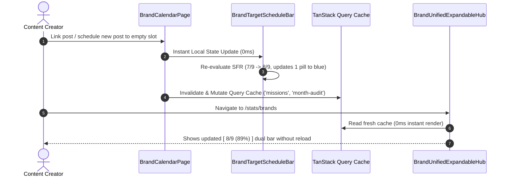

# Plan 8: Client Target Schedule Fulfillment Specification (Combo A + B)
**Real-Time Quota Health, Multi-View Agency Matrix, & 0ms Cache Synchronization**

---

## 1. Executive Summary & Problem Landscape

In a professional social media marketing agency, client contracts define monthly deliverables (e.g. *20 Posters, 4 Videos, 2 Live Streams* = 26 Target Posts). The content and media management team schedules these deliverables days or weeks in advance using Meta Business Suite and MoonPulse.

### The Operational Gap:
1. **False "Incomplete" Dilemma:** The current system only measured `completed_slots` (posts that are already published live). When an agency team diligently finished scheduling all 26 posts for the month by the 5th of November, the system displayed `0%` or low completion rates because the scheduled posts haven't published yet.
2. **Blind Spot for Account Managers:** Agency directors and account managers previously had no high-level view showing which client brands have all their posts scheduled for the month and which client accounts are under-scheduled and at risk.
3. **Friction in Spotting Schedule Progress:** Content creators looking at a monthly calendar had to manually count slots to identify how many posts were scheduled and how many remained to fulfill client targets.

### The Solution (Combo A + B with Option 3 Split Dual Tracks):
* **Part A (Execution View - Brand Calendar `/calendar`):** Real-time **Target Schedule Health Bar** displaying live fulfillment status:
  - **Standard Architecture (Option 3 - Split Dual Tracks):**
    - **Track 1 (Schedulable Posts):** Evaluates Posters + Videos progress ($P + S / T_{\text{posts}}$) without penalizing content creators for unstreamed live events. In Single Brand view, rendered as discrete unit blocks ($24\text{px} \times 17\text{px}$); in Master view, rendered as continuous dual-fill linear track.
    - **Track 2 (Live Broadcasts):** Dedicated real-time live event track ($L_{\text{covered}} / L_{\text{target}}$) with signature live rose/pink gradient pills and bar.
  - **Deliverable Breakdown:** Themed color chips for Posters (Green), Videos (Purple), and Lives (Rose) with clean `X/Y` ratios.
  - **Clean Neutral Card Styling:** Consistent pure white card (`#ffffff`) background without distracting colored tints or alarm boxes.
* **Part B (Management View - Brands Command Center `/stats/brands`):** Master operations matrix column indicating **Target Schedule Health** with dual split rows:
  - **Row 1:** Posts fulfillment (`Posts: X/Y (Z%)` with dual green/blue bar).
  - **Row 2:** Live broadcasts fulfillment (`Lives: A/B (C%)` with rose bar, only shown when brand has live quota).
  - Filter tabs (`✅ គ្រប់ Target`, `⚠️ នៅខ្វះ Schedule`), and 1-click deep navigation directly into any brand's calendar.

---

## 2. Mathematical Formulation & Status Definitions

For any brand $B$ in month $M$ and year $Y$:

$$\text{Total Target Deliverables } (T) = \sum \text{Slots in Mission Blueprint}$$

$$\text{Published Deliverables } (P) = \sum \text{Slots with } \text{status} \in \{\text{'completed'}, \text{'compensated'}\}$$

$$\text{Scheduled Deliverables } (S) = \sum \text{Slots with } \text{status} = \text{'scheduled'}$$

$$\text{Covered Deliverables } (C) = P + S$$

$$\text{Remaining Unscheduled Slots } (R) = \max(0, T - C)$$

$$\text{Schedule Fulfillment Rate (SFR)} = \begin{cases} 
\text{Round}\left(\frac{C}{T} \times 100\right)\%, & T > 0 \\
0\%, & T = 0 
\end{cases}$$

### Operational Status States:

| State Key | Label & Badge | Visual Indicator | Trigger Condition |
| :--- | :--- | :--- | :--- |
| `FULLY_SCHEDULED` | **✅ គ្រប់ Target (Fully Scheduled)** | Emerald Green (`#16a34a`) | $C \ge T$ and $T > 0$ ($R = 0$) |
| `NEEDS_SCHEDULING` | **⚠️ នៅខ្វះ Schedule** | Amber / Orange (`#f59e0b`) | $C < T$ and no past uncompensated missed slots |
| `OVERDUE_AT_RISK` | **🚨 មាន Missed Slot ត្រូវផុសសង** | Crimson Red (`#dc2626`) | $\ge 1$ past slot without post and uncompensated |
| `UNPLANNED` | **⚪ មិនទាន់មាន Target Blueprint** | Slate Gray (`#64748b`) | $T = 0$ (no mission blueprint configured) |

---

## 3. UI/UX Architecture & Production Layout

### 3.1 Part A: Brand Calendar Page (`/calendar`)

Placed directly above the Calendar Grid, the component renders in a compact, balanced 2-row layout with neutral white styling:

#### 1. Single Brand View (Option 3 Split Dual Tracks):
```
+---------------------------------------------------------------------------------------------------------------------------------+
| [Logo] Baby Love                                                                                 Posts: [🟢🟢🟢 🔵🔵🔵] 100% (6/6) |
|        6 Target Posts • 3 Target Lives                                                           Lives: [🔴 ⚪ ⚪]    33% (1/3) |
| - - - - - - - - - - - - - - - - - - - - - - - - - - - - - - - - - - - - - - - - - - - - - - - - - - - - - - - - - - - - - - - - |
| Target Breakdown: [🖼️ Posters: 6/6 ✅] [📹 Videos: 0/0] [🔴 Lives: 1/3]       ● 3 Published  ● 3 Scheduled  ● 1 Lives  ● 2 Unsched |
+---------------------------------------------------------------------------------------------------------------------------------+
```
* **Row 1 (`brand-target-header`):**
  - **Left (`brand-target-brand-meta`):** Brand Logo Avatar + Brand Name + `X Target Posts • Y Target Lives`.
  - **Right (`brand-target-progress`):** Sized-Up Split Dual Tracks:
    - **Posts Track:** Distinct unit blocks ($25\text{px} \times 17\text{px}$) showing Schedulable Posts fulfillment (e.g. `100% (6/6)`).
    - **Lives Track:** Signature live rose blocks showing broadcast fulfillment (e.g. `33% (1/3)`).
* **Row 2 (`brand-target-footer` - under dashed line `------`):**
  - **Left (`brand-target-breakdown`):** **Target Breakdown Chips** (Posters, Videos, Lives) with `X/Y` counts and checkmark.
  - **Right (`brand-target-legend`):** **Status Legend Dots** (`● Published  ● Scheduled  ● Lives Done  ● Unscheduled`).

#### 2. All Brands Master View (Master Schedule):
```
+---------------------------------------------------------------------------------------------------------------------------------+
| [Layers] All Contracted Brands (Master Schedule)                      [ ███████████████████████░░░░░░░░ ]  75% (95 of 126 Posts) |
|          18 Contracted Brands • 126 Target Posts                      ● 73 Published (58%)  ● 22 Scheduled (17%)  ● 31 Unscheduled|
| - - - - - - - - - - - - - - - - - - - - - - - - - - - - - - - - - - - - - - - - - - - - - - - - - - - - - - - - - - - - - - - - |
| Target Breakdown:   [ 🖼️ Posters: 69/78 ]     [ 📹 Videos: 0/2 ]     [ 🔴 Lives: 26/46 ]                                        |
+---------------------------------------------------------------------------------------------------------------------------------+
```
* **Top-Left:** Layers Icon + `All Contracted Brands (Master Schedule)` + `18 Contracted Brands • 126 Target Posts`.
* **Top-Right (Continuous Linear Track - Old Style):**
  - Continuous dual-fill track (width `260px`, height `16px`, pill radius `999px`) with Emerald published fill + Royal Blue scheduled fill.
  - Fulfillment percentage badge `75% (95 of 126 Posts)`.
  - Status Legend below: `● 73 Published (58%)  ● 22 Scheduled (17%)  ● 31 Unscheduled`.

#### 3. Target Breakdown Chips (Row 2):
* **No Shortage Numbers:** Removed negative suffix `(-2)` per user direction.
* **Themed Colors:**
  - **Posters:** Emerald light background (`#f0fdf4`), green border (`#bbf7d0`), icon `#16a34a`.
  - **Videos:** Purple light background (`#faf5ff`), purple border (`#e9d5ff`), icon `#9333ea`.
  - **Lives:** Rose light background (`#fff1f2`), rose border (`#fecdd3`), icon `#e11d48`.
* **Clean 0/0 State:** 0/0 counts remain in their proper theme colors instead of grayed out.

#### 4. Neutral White Card Styling:
* Card background is always pure white (`#ffffff`) with standard subtle border (`#e2e8f0`).
* No full-card color changes (no yellow `#fffbeb` or pink `#fef2f2` tints) ensuring a distraction-free, professional interface.

---

### 3.2 Part B: Brands Command Center (`/stats/brands`)

In `BrandUnifiedExpandableHub.jsx`, the Master Operations Matrix contains:

1. **"Target Schedule Health" Column:**
   - Dual-color progress bar (Emerald published + Royal Blue scheduled + Slate unscheduled).
   - Clean ratio display: `{coveredSlots} / {totalSlots} ({scheduleCoverageRate}%)` with `✅ គ្រប់ Target` badge when fully satisfied (no warning icons `⚠️` or shortage alarms).
2. **Operations Filter Options:**
   - Filter dropdown includes `✅ គ្រប់ Target` and `⚠️ នៅខ្វះ Schedule`.
   - Sort dropdown includes `Sort: Schedule Fulfillment`.
3. **KPI Summary Cards:**
   - Updated KPIs to track `✅ គ្រប់ Target` and `Deliverables Covered` with schedule coverage percentage.
4. **1-Click Deep Navigation (`📅 Calendar`):**
   - Quick action button navigating directly to `/calendar?brand_id={brand_id}&month={m}&year={y}`.

---

## 4. Backend Architecture & Data Pipeline

### Enhanced `getMonthAudit(month, year)` in `missions.service.js`:

```javascript
// Calculate scheduled metrics alongside completed
let scheduledSlots = 0;
enrichedSlots.forEach((slot) => {
  if (slot.computed_status === 'scheduled') {
    scheduledSlots += 1;
  }
});

const coveredSlots = completedSlots + scheduledSlots;
const remainingSlots = Math.max(0, totalSlots - coveredSlots);
const scheduleCoverageRate = totalSlots > 0 ? Math.round((coveredSlots / totalSlots) * 100) : 0;

// Breakdown with scheduled awareness
const postersScheduled = enrichedSlots.filter(
  (s) => (s.content_type === 'photo' || s.content_type === 'poster') &&
         (s.computed_status === 'completed' || s.computed_status === 'scheduled' || s.computed_status === 'compensated')
).length;

const videosScheduled = enrichedSlots.filter(
  (s) => (s.content_type === 'video' || s.content_type === 'reel') &&
         (s.computed_status === 'completed' || s.computed_status === 'scheduled' || s.computed_status === 'compensated')
).length;

const livesScheduled = enrichedSlots.filter(
  (s) => s.content_type === 'live' &&
         (s.computed_status === 'completed' || s.computed_status === 'scheduled' || s.computed_status === 'compensated')
).length;

auditList.push({
  ...baseAudit,
  total_slots: totalSlots,
  completed_slots: completedSlots,
  scheduled_slots: scheduledSlots,
  covered_slots: coveredSlots,
  remaining_slots: remainingSlots,
  schedule_coverage_rate: scheduleCoverageRate,
  is_fully_scheduled: totalSlots > 0 && coveredSlots >= totalSlots,
  breakdown: {
    posters: { target: postersTarget, completed: postersCompleted, scheduled: postersScheduled },
    videos: { target: videosTarget, completed: videosCompleted, scheduled: videosScheduled },
    lives: { target: livesTarget, completed: livesCompleted, scheduled: livesScheduled },
  },
});
```

---

## 5. Multi-Tier Cache Synchronization (0ms Optimistic Latency)



---

## 6. Implementation Checklist & Verification

### Phase 1: Backend Service Enrichment
- [x] Enrich `missions.service.js` with `scheduled_slots`, `covered_slots`, `remaining_slots`, `schedule_coverage_rate`, and `is_fully_scheduled`.
- [x] Add scheduled post counters to deliverable breakdowns (posters, videos, lives).
- [x] Verified via Node syntax check: `node -e "require('./server/src/modules/missions/missions.service.js')"` passed with 0 errors.

### Phase 2: Calendar Target Health Bar (Part A)
- [x] Created `frontend/src/features/calendar/components/BrandTargetScheduleBar.jsx`.
- [x] Integrated component into `BrandCalendarPage.jsx` above calendar grid.
- [x] Added status indicator badges (`Brand ✅ (10/10)`, `Brand ⚠️ (7/10)`) into Brand Select Dropdown.
- [x] Implemented **Concept 3 (Discrete Unit Blocks)** for Single Brand view: 1-to-1 matching ($1 \text{ post} = 1 \text{ pill}$), width `24px`, height `17px`.
- [x] Implemented **Continuous Linear Track (Old Style)** for All Brands view: continuous dual-color track, width `260px`, height `16px`.
- [x] Placed both progress bars in the **Top-Right** of the header for optimal screen space usage.
- [x] Cleaned card background to pure white (`#ffffff`) without status tint gradients.
- [x] Optimized breakdown chips with themed colors (Green posters, Purple videos, Rose lives) and removed `(-X)` shortage numbers.
- [x] Styled in `frontend/src/features/calendar/calendar.css`.

### Phase 3: Brands Command Center Matrix (Part B)
- [x] Updated `frontend/src/features/missions/components/BrandUnifiedExpandableHub.jsx` to render dual-progress `Target Schedule Health` column.
- [x] Added filter dropdown options: `✅ គ្រប់ Target` and `⚠️ នៅខ្វះ Schedule`.
- [x] Added sort option: `Sort: Schedule Fulfillment`.
- [x] Added direct `📅 Calendar` navigation button leading to `/calendar?brand_id={id}&month={m}&year={y}`.
- [x] Updated KPI cards with schedule fulfillment rates.

### Phase 4: Production Build Verification
- [x] Ran `npm run build --prefix frontend` $\rightarrow$ Built in 1.16s with **0 errors**.
